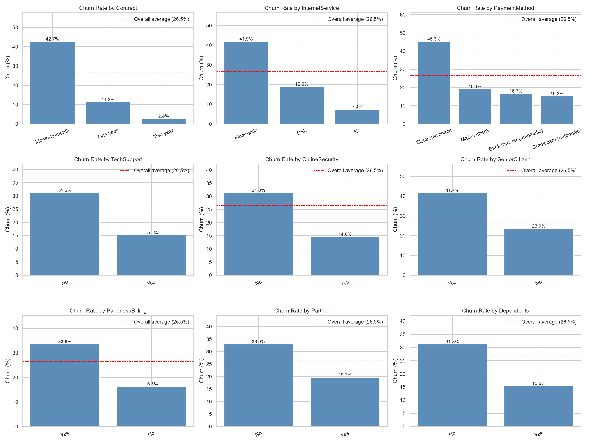
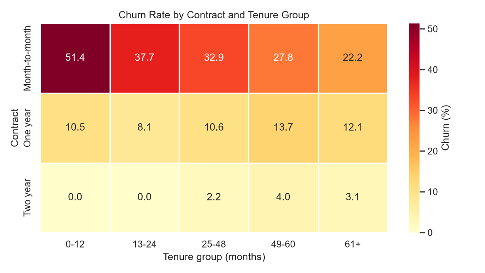
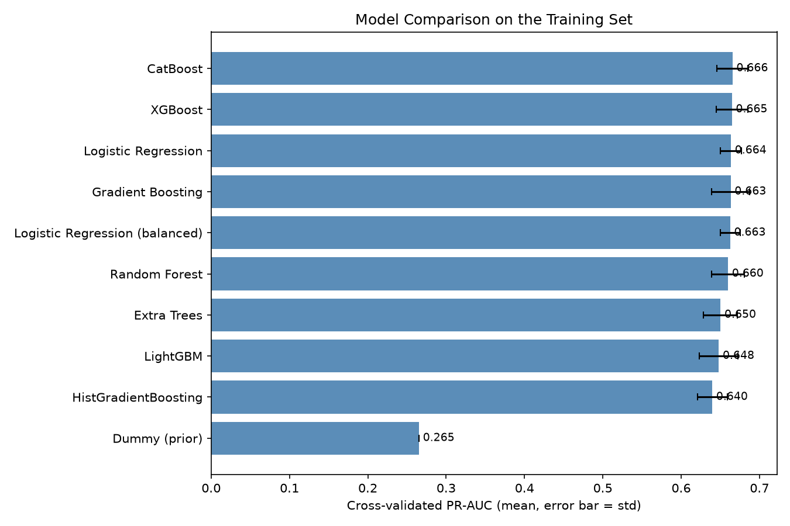
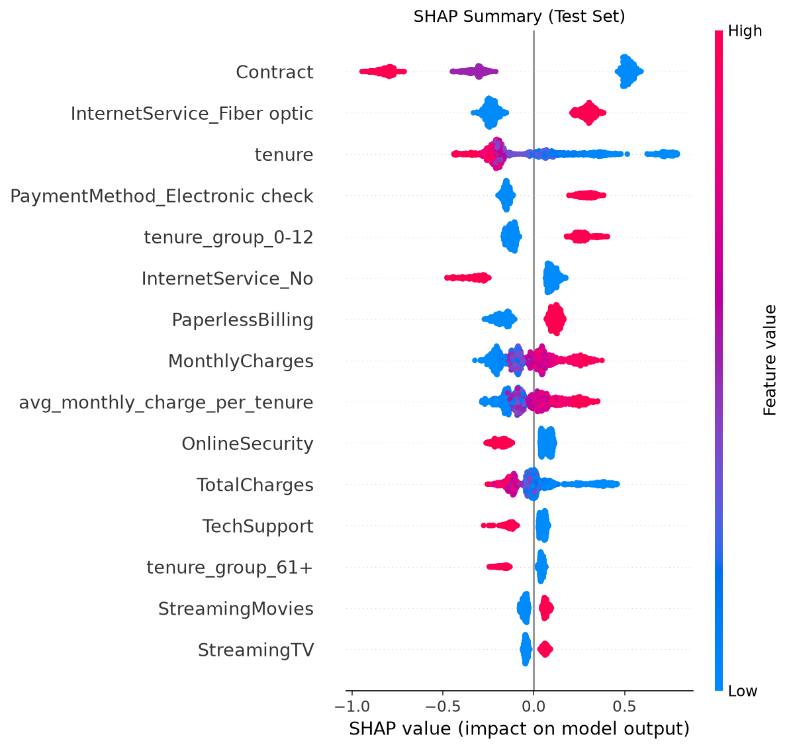
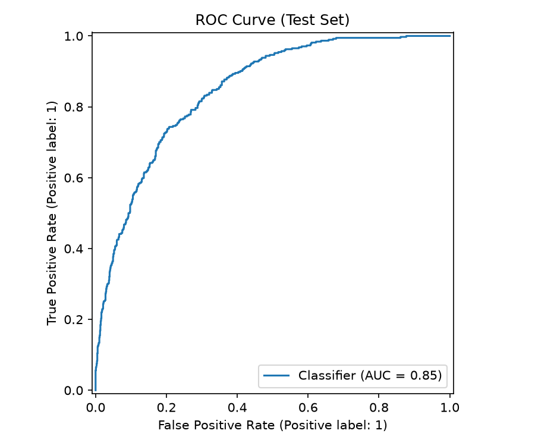
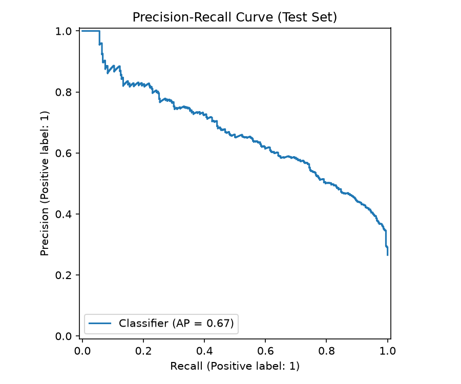
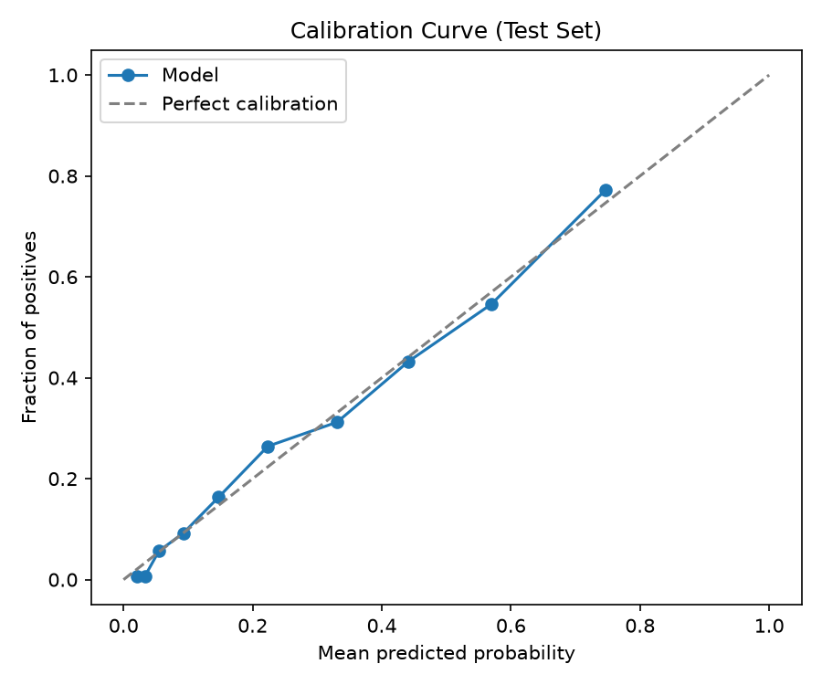
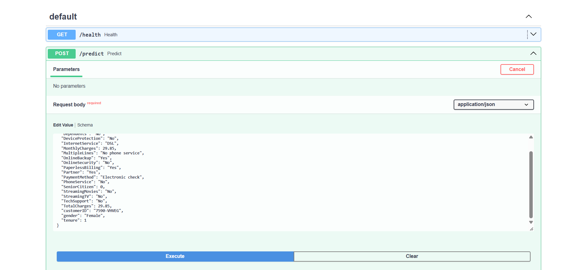
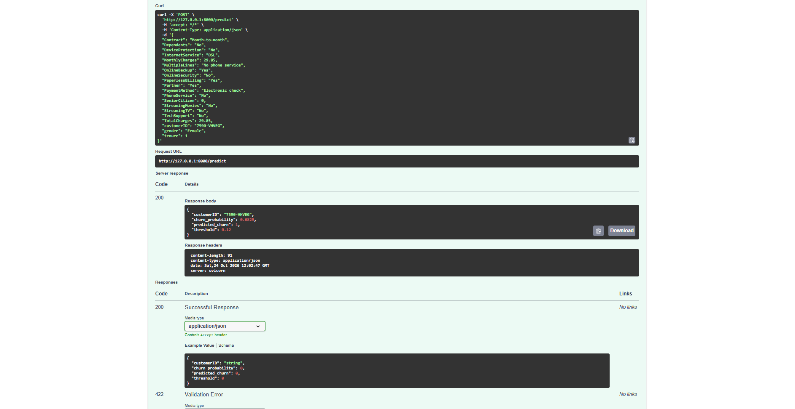
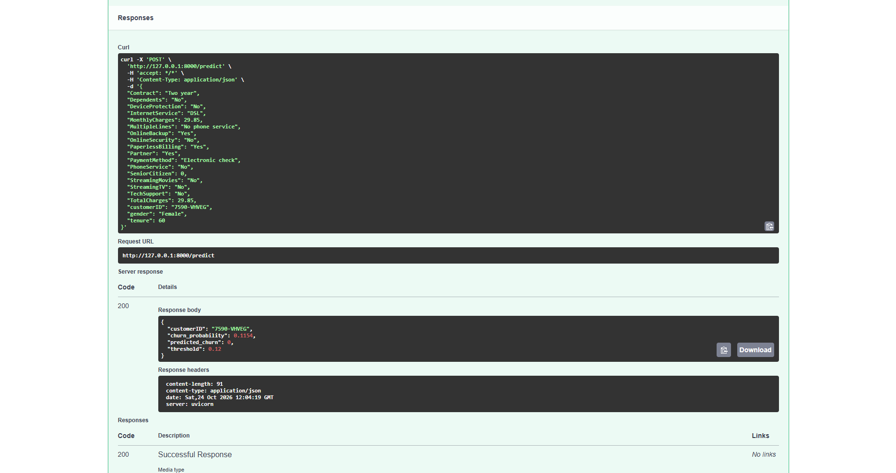

# Telco Customer Churn Prediction

End-to-end machine learning project that predicts which telecom customers are likely to churn and turns the prediction into a cost-based retention decision. It covers data cleaning, exploratory analysis, cross-validated model comparison, hyperparameter tuning, explainability with SHAP, a tested FastAPI service and a Docker image.

## Highlights

- Dataset: IBM Telco Customer Churn (7,043 customers, 26.5% churn).
- Final model: tuned Gradient Boosting pipeline with scaling, one-hot encoding and engineered features. The decision threshold is chosen from out-of-fold predictions using an explicit false-positive / false-negative cost trade-off.
- Held-out test performance: ROC-AUC 0.847, PR-AUC 0.668, Brier score 0.135, with well-calibrated probabilities.
- Randomized search with 5-fold cross-validation rejected SMOTE, so the final pipeline uses no oversampling.
- Served through a FastAPI application with input validation, 15 automated tests and a Docker image.

## Business Impact

Decision threshold: 0.12, selected on out-of-fold predictions from the training set only.

| Strategy (test set, 1,409 customers) | Total cost |
|---|---|
| No retention action | 112,200 |
| Contact every customer | 51,750 |
| Model-based targeting | 31,450 |

At this threshold the model catches 350 of 374 churners (recall 0.94) with precision 0.42.

Cost assumptions (editable in `src/config.py`): a retention offer sent to a customer who would not have left costs 50, and losing a churner costs 300. These are illustrative assumptions, not company data, and the result depends on them. A campaign with a limited budget would need a capacity-based cut-off, such as targeting only the highest-risk share of customers.

## Key Findings from EDA

- Month-to-month contracts churn at 42.7% versus 2.8% for two-year contracts.
- Customers in their first 12 months churn at 47.4%, versus 6.6% after 61 months.
- Fiber optic customers churn at 41.9% and electronic check payers at 45.3%.
- Customers without tech support or online security churn roughly twice as often as those with them.
- The strongest associations with churn (Cramer's V) are Contract (0.41), tenure group (0.35), InternetService (0.32) and PaymentMethod (0.30).
- Tenure and TotalCharges are strongly correlated (0.83).




## Model Comparison

All models share the same preprocessing and the same 5-fold stratified cross-validation on the training set. The test set was not used for model selection.

| Model | ROC-AUC | PR-AUC (std) | PR-AUC train-CV gap |
|---|---|---|---|
| CatBoost | 0.8463 | 0.6655 (0.020) | 0.091 |
| XGBoost | 0.8462 | 0.6648 (0.020) | 0.091 |
| Logistic Regression | 0.8462 | 0.6635 (0.013) | 0.009 |
| Gradient Boosting | 0.8467 | 0.6632 (0.025) | 0.088 |
| Logistic Regression (balanced) | 0.8460 | 0.6626 (0.013) | 0.008 |
| Random Forest | 0.8437 | 0.6598 (0.021) | 0.204 |
| Extra Trees | 0.8419 | 0.6503 (0.022) | 0.187 |
| LightGBM | 0.8386 | 0.6480 (0.025) | 0.211 |
| HistGradientBoosting | 0.8329 | 0.6397 (0.019) | 0.269 |
| Dummy | 0.5000 | 0.2654 (0.000) | 0.000 |

The top four models are within one standard deviation of each other, so a plain Logistic Regression performs as well as the boosted trees on this dataset and overfits far less. Gradient Boosting was tuned with a randomized search (40 configurations, cross-validated PR-AUC 0.668). That figure is the best of many configurations evaluated on the same folds, so it is not directly comparable to the default-parameter scores above. The held-out test PR-AUC of 0.668 confirms that the tuned model generalizes. A regularized linear model remains a reasonable and more interpretable alternative.



## Explainability

SHAP values on the held-out test set show that contract type, fiber optic internet, tenure, electronic check payment and paperless billing drive most predictions. The direction of every effect agrees with the exploratory analysis.



## Evaluation Plots





## Project Structure

```
.
├── app/                    FastAPI application and request schemas
├── data/
│   ├── raw/                original Telco CSV
│   └── processed/          cleaned data
├── models/                 trained model package
├── reports/
│   ├── figures/            EDA, SHAP and evaluation figures
│   ├── screenshots/        API examples
│   ├── metrics.json        final test metrics
│   └── *.csv, *.md         model comparison, SHAP and EDA summaries
├── src/
│   ├── config.py           paths and constants
│   ├── cleaning.py         data cleaning
│   ├── features.py         feature engineering
│   ├── train.py            tuning, threshold selection, evaluation
│   ├── compare_models.py   cross-validated model comparison
│   ├── explain.py          SHAP analysis
│   ├── eda.py              exploratory analysis figures
│   └── predict.py          batch and single prediction
├── tests/                  pytest suite
├── Dockerfile
└── requirements*.txt
```

## Getting Started

Python 3.12 is recommended. Install the dependencies:

```
pip install -r requirements-dev.txt
```

The raw dataset is included at `data/raw/WA_Fn-UseC_-Telco-Customer-Churn.csv`. Run the pipeline from the project root:

```
python -m src.eda
python -m src.compare_models
python -m src.train
python -m src.explain
```

Predict from a raw CSV file:

```
python -m src.predict --input data/raw/WA_Fn-UseC_-Telco-Customer-Churn.csv
```

Run the tests:

```
python -m pytest
```

The trained model in `models/` was created with scikit-learn 1.9.1 and imbalanced-learn 0.14.2. Use the pinned versions from `requirements.txt` to load it without warnings.

## API

Start the service locally:

```
python -m uvicorn app.main:app --reload
```

Interactive documentation is available at `http://127.0.0.1:8000/docs`.

| Endpoint | Description |
|---|---|
| `GET /health` | Model status and decision threshold |
| `POST /predict` | Churn probability and decision for one customer |
| `POST /predict/batch` | Up to 1,000 customers per request |

Requests are validated with Pydantic. Unknown categories or invalid numeric values return a 422 response.

A high-risk customer (month-to-month contract, one month of tenure, electronic check) receives a churn probability of 0.68 and is flagged. A long-tenure customer on a two-year contract receives 0.12 and falls just below the threshold.





## Docker

```
docker build -t churn-api .
docker run -p 8000:8000 churn-api
```

The image contains only the dependencies required for inference.

## Limitations

- The dataset is a single snapshot, so the model cannot be validated on a later time period.
- Cost values are illustrative assumptions and should be replaced with real campaign economics.
- The threshold of 0.12 flags a large share of customers, which assumes a retention offer is cheap relative to a lost customer.
- Model monitoring and drift detection are not implemented.

## Tech Stack

Python, pandas, NumPy, scikit-learn, imbalanced-learn, XGBoost, LightGBM, CatBoost, SHAP, FastAPI, Pydantic, pytest, Docker.
